# devsecops-pipeline: architecture

Decisions and their reasons are in [`design.md`](design.md). This page is the system view.

## 1. Context

Security tools in most pipelines produce reports that nobody reads. This pipeline treats each check as a **gate**: a finding fails the build. It ties what was scanned to what runs, so a cluster only admits an image the pipeline built, scanned, and signed. And it keeps checking after release, because new CVEs are published every day.

```mermaid
flowchart LR
  dev["commit"] --> g10["10 secrets<br/>gitleaks (history)"] --> g20["20 SAST<br/>semgrep + project rules"] --> g30["30 deps<br/>trivy fs, hashed lockfile"]
  g30 --> g40["40 Dockerfile<br/>hadolint"] --> g50["50 manifests<br/>kube-linter, trivy config"] --> g60["60 tests + build<br/>one image, built once"]
  g60 --> g70["70 image<br/>trivy image"] --> g80["80 SBOM<br/>syft: CycloneDX + SPDX"] --> g90["90 DAST<br/>ZAP baseline"] --> g95["95 sign + admit<br/>cosign, Kyverno in kind"]
  g95 -- main only --> pub["GHCR push by digest,<br/>keyless signature,<br/>signed SBOM, SLSA provenance"]
  pub --> daily["96 daily re-scan<br/>verify SBOM attestation,<br/>scan vs today's CVE DB"]
  daily -- new fixable CVEs --> issue["GitHub issue"]
```



## 2. Principles

| Principle | Implementation |
|---|---|
| **Scanned = shipped** | One image, built once (`IMAGE`). The SBOM is generated from it, the signature covers its digest, and the cluster pins the digest. A rebuild "to push" would produce a different, unscanned digest. |
| Gates, not reports | Every stage exits non-zero on findings; thresholds are HIGH/CRITICAL **with a fix available**, so a red build always has a next step |
| Tools are supply chain too | Every scanner image is pinned by digest (`ci/tools.env`) |
| CI-agnostic | Each stage is a bash script in `ci/`; GitHub Actions and Jenkins only order them and hold credentials. Source goes into tool containers by `docker cp`, which works where bind mounts don't (Jenkins in a container, dind). |
| Prove the gates work | `demo/break-it.sh` seeds one flaw per gate in a throwaway copy, and CI requires each gate to fail |
| Admission is the last word | Kyverno rejects images that aren't signed by this workflow's identity, or that lack a signed SBOM attestation, or that come from another registry |

## 3. Trust chain

```mermaid
sequenceDiagram
  participant P as pipeline (main)
  participant F as Fulcio / Rekor (Sigstore)
  participant R as GHCR
  participant K as cluster (Kyverno)
  participant D as daily re-scan
  P->>F: OIDC token (identity = this workflow on main)
  F-->>P: short-lived certificate; signature logged in Rekor
  P->>R: push image by digest, signature, SBOM attestation, SLSA provenance
  K->>R: verify signature + attestation for the digest at admission
  D->>R: verify the SBOM attestation (same identity), then scan the SBOM
```

There are no long-lived signing keys. Keyless signing binds the signature to the workflow identity, and the transparency log makes every signature auditable. A consumer verifies with `--certificate-identity` and `--certificate-oidc-issuer`, exactly as the pipeline's last step does.

## 4. Continuous re-scanning

- **What runs:** `rescan.yml`, daily and on demand. It finds the newest image published from `main` (images are tagged with the commit), verifies its CycloneDX attestation against this pipeline's identity, extracts the SBOM, and scans it with the pinned Trivy.
- **Why the SBOM and not the image:** no pull and no rebuild, and the SBOM that was signed at release is exactly what shipped.
- **Trust:** an unsigned SBOM, or one signed by a different identity, is refused (exit 2). Otherwise an attacker who could push to the registry could also feed the re-scan a clean SBOM.
- **Outcome:** fixable HIGH/CRITICAL findings open an issue, or update the open one, so a new CVE in a released image becomes tracked work.
- **Self-test:** before scanning the real image, the job scans the SBOM of an old base image (python 3.12.0) and must find fixable HIGH/CRITICAL CVEs. A green re-scan from a broken scanner is the failure it guards against.

## 5. What each gate caught while the project was built

- **The image scan** found 3 HIGH CVEs in a transitive dependency (Starlette) that the dependency scan couldn't see, because only direct dependencies were listed. The fix was a fully hashed lockfile.
- **semgrep's public packs** missed an f-string SQL injection into `sqlite3.execute()`. The fix was a project rule, and a seeded test keeps it honest.
- **kube-linter** flagged a PodDisruptionBudget without `unhealthyPodEvictionPolicy`.

## 6. Testing

| Job | Proves |
|---|---|
| `pipeline` | All gates pass on the real app; on `main`, publish, sign, attest and verify as a consumer |
| `gates-catch-flaws` | Each of the seeded flaws is caught by its gate (7 of 7) |
| Kyverno in kind (stage 95) | Signed image admitted; unsigned build and foreign registry rejected |
| `rescan` self-test | The re-scan finds the known vulnerabilities in an old SBOM |
| Jenkins (homelab) | The same scripts run unchanged on a second CI system |

## 7. Next steps

- Kyverno CLI against the manifests in CI, so a policy violation fails the pull request, not the deploy.
- An authenticated, OpenAPI-driven DAST scan of the write endpoints.
- A distroless or Chainguard base image; External Secrets and KMS for runtime secrets.
